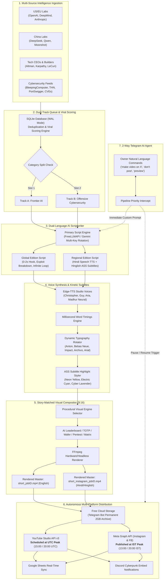
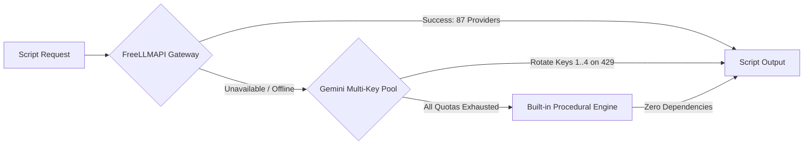

<div align="center">

# ⚡ CyberShorts AI: Autonomous Video Production Agent

> **Enterprise-grade, zero-cost, 24/7 autonomous video production & multi-platform publishing agent.**  
> Built for Frontier AI, Tech Breakthroughs, Offensive Cybersecurity & Web Penetration Testing.

[](https://python.org)
[](https://ffmpeg.org)
[](https://youtube.com)
[](https://developers.facebook.com)
[](https://telegram.org)
[](https://sheets.google.com)
[](https://discord.com)
[](https://github.com/tashfeenahmed/freellmapi)
[](LICENSE)

<br/>

```
  ██████╗██╗   ██╗██████╗ ███████╗██████╗ ███████╗██╗  ██╗ ██████╗ ██████╗ ████████╗███████╗
 ██╔════╝╚██╗ ██╔╝██╔══██╗██╔════╝██╔══██╗██╔════╝██║  ██║██╔═══██╗██╔══██╗╚══██╔══╝██╔════╝
 ██║      ╚████╔╝ ██████╔╝█████╗  ██████╔╝███████╗███████║██║   ██║██████╔╝   ██║   ███████╗
 ██║       ╚██╔╝  ██╔══██╗██╔══╝  ██╔══██╗╚════██║██╔══██║██║   ██║██╔══██╗   ██║   ╚════██║
 ╚██████╗   ██║   ██████╔╝███████╗██║  ██║███████║██║  ██║╚██████╔╝██║  ██║   ██║   ███████║
  ╚═════╝   ╚═╝   ╚═════╝ ╚══════╝╚═╝  ╚═╝╚══════╝╚═╝  ╚═╝ ╚═════╝ ╚═╝  ╚═╝   ╚═╝   ╚══════╝
                     AUTONOMOUS MULTI-PLATFORM VIDEO PRODUCTION ENGINE
```

<p align="center">
  <b>Dual-Track Daily Releases:</b> 1 Frontier AI Video + 1 Offensive Cybersecurity Video<br/>
  <b>Dual-Timezone Publishing:</b> YouTube in <b>UTC Peak</b> (Global) • Instagram & FB in <b>IST Peak</b> (India)<br/>
  <b>Dual-Language Intelligence:</b> English Global Edition + Hindi Voice & Hinglish Subtitles Edition
</p>

</div>

---

## 📑 Table of Contents

- [🌟 System Highlights](#-system-highlights)
- [🏗️ High-Level System Architecture](#️-high-level-system-architecture)
- [🌐 Dual-Timezone Scheduling Architecture](#-dual-timezone-scheduling-architecture)
- [🎙️ Dual-Language & Cross-Cultural Video Pipeline](#️-dual-language--cross-cultural-video-pipeline)
- [🎬 10 Procedural Story-Matched Visual Engines](#-10-procedural-story-matched-visual-engines)
- [🤖 2-Way Interactive Telegram AI Agent](#-2-way-interactive-telegram-ai-agent)
- [🧠 4-Category Multi-Source Intelligence Ingestion](#-4-category-multi-source-intelligence-ingestion)
- [🔄 Dynamic Style, Voice & Typography Rotator](#-dynamic-style-voice--typography-rotator)
- [⚡ FreeLLMAPI & Zero-Cost Failover System](#-freellmapi--zero-cost-failover-system)
- [📊 Telemetry, Google Sheets & Discord Alerts](#-telemetry-google-sheets--discord-alerts)
- [🚀 Quickstart & Installation](#-quickstart--installation)
- [⚙️ Configuration Reference (.env)](#️-configuration-reference-env)
- [📁 Repository Structure](#-repository-structure)
- [📜 License](#-license)

---

## 🌟 System Highlights

| Feature | Description | Benefit |
| :--- | :--- | :--- |
| **Strict Dual-Niche Split** | Daily cap of 2 videos: exactly **1 Frontier AI** + **1 Offensive Cybersecurity**. | Balances high-growth AI news with core hacking/cyber community reach. |
| **Dual-Timezone Scheduling** | YouTube Shorts timed to **UTC Peak** (`15:00` & `20:00 UTC`), Instagram/FB to **IST Peak** (`13:00` & `20:00 IST`). | Captures US/European tech workers at lunch & Indian viewers during prime scroll. |
| **Dual-Language Video Engines** | Generates 2 editions per job: English for YouTube & Hindi speech + Hinglish transcript for Instagram (`alex.cyberx` style). | Maximizes international reach without alienating high-retention regional audiences. |
| **10 Procedural Visual Scenes** | Rendered with pure Python & FFmpeg: AI Leaderboard, TOTP Authenticator, 4nm Wafer, Prompt Injection, Burp Pentest, Terminal, etc. | High visual retention matching the exact story vibe without expensive stock footage. |
| **2-Way Telegram AI Agent** | 24/7 interactive bot: create on custom prompt, pause drops (`don't post`), resume, preview video, check stats. | Full mobile command and control of your media company from your pocket. |
| **FreeLLMAPI & Key Failover** | Aggregates 87 free providers (10.1B tokens/mo) + multi-key Gemini rotation + procedural fallback. | Zero monthly API costs. Video production is 100% guaranteed never to crash or stall. |
| **Free Unlimited Cloud Storage** | Telegram Bot API acts as a permanent 2 GB cloud drive for all rendered media. | Zero cloud storage bill; instant public streaming links for Meta Graph API. |
| **Full Telemetry Dashboard** | Real-time FastAPI Mission Control + Google Sheets auto-sync + Discord cyberpunk embed alerts. | Complete observability of viral scores, word counts, execution logs, and live URLs. |

---

## 🏗️ High-Level System Architecture



---

## 🌐 Dual-Timezone Scheduling Architecture

Tech audiences have fundamentally different peak scroll windows across global and domestic markets:

```
  ┌────────────────────────────────────────────────────────────────────────────────────────┐
  │                                GLOBAL YOUTUBE TIMING (UTC)                              │
  │  00:00 UTC            08:00 UTC             15:00 UTC              20:00 UTC           │
  │  ───────┴─────────────────┴─────────────────────▲──────────────────────▲───────────────│
  │                                             DROP 1 (10 AM EST)     DROP 2 (3 PM EST)   │
  │                                             US Morning Tech        US Afternoon Tech   │
  └────────────────────────────────────────────────────────────────────────────────────────┘

  ┌────────────────────────────────────────────────────────────────────────────────────────┐
  │                              INDIAN INSTAGRAM & FB TIMING (IST)                        │
  │  00:00 IST            08:00 IST             13:00 IST              20:00 IST           │
  │  ───────┴─────────────────┴─────────────────────▲──────────────────────▲───────────────│
  │                                             DROP 1                 DROP 2              │
  │                                             Lunch Break Scroll     Prime Evening Peak  │
  └────────────────────────────────────────────────────────────────────────────────────────┘
```

- **YouTube Shorts:** Auto-scheduled via `publishAt` parameter to **`15:00 UTC`** (10:00 AM EST) and **`20:00 UTC`** (3:00 PM EST), matching North American and European developer work hours.
- **Instagram Reels & Facebook:** Published during **`13:00 IST`** (Lunch hour mobile browsing) and **`20:00 IST`** (Evening relaxation scroll).

---

## 🎙️ Dual-Language & Cross-Cultural Video Pipeline

For every video topic, CyberShorts produces **two synchronized, platform-tailored editions**:

```
                                  [Story / Prompt Ingested]
                                              │
                      ┌───────────────────────┴───────────────────────┐
                      ▼                                               ▼
         ┌─────────────────────────┐                     ┌─────────────────────────┐
         │     GLOBAL EDITION      │                     │      INDIA EDITION      │
         │  (YouTube Studio Shorts)│                     │ (Instagram & Facebook)  │
         ├─────────────────────────┤                     ├─────────────────────────┤
         │ • Language: English     │                     │ • Audio: Hindi Neural   │
         │ • Voice: Christopher    │                     │   (hi-IN-MadhurNeural)  │
         │ • Subtitles: English    │                     │ • Subtitles: Hinglish   │
         │ • Timed for: UTC Peak   │                     │   (Latin Script)        │
         │ • Color: Dynamic Neon   │                     │ • Color: Cyber Lavender │
         └─────────────────────────┘                     └─────────────────────────┘
```

### Hinglish Subtitle Formatting Example:
> **Hindi Speech:** *"आज हम बात कर रहे हैं DeepSeek-R1 के नए आर्किटेक्चर के बारे में जिसने पूरी दुनिया को हिला दिया..."*  
> **Hinglish Captions Burned into Video:**  
> `Aaj hum baat kar rahe hain DeepSeek-R1 ke naye architecture ke baare mein...`

---

## 🎬 10 Procedural Story-Matched Visual Engines

No static boring stock footage. The engine selects and animates procedural visuals matched to the exact semantic vibe of the headline:

| Visual Mode | Scene Description | Target Topics |
| :--- | :--- | :--- |
| 📊 `AI_LEADERBOARD` | Live benchmark bars comparing DeepSeek-R1 vs Claude 3.7 vs OpenAI o3 vs Gemini 2.0 with live token pricing. | LLM model releases, benchmark wars, reasoning models. |
| ⏱️ `TECH_EXPLAINER` | Animated Google Authenticator TOTP countdown clock, 19B transistor 4nm EUV wafer from sand, SIM theft lock. | Hardware chips, authentication, architecture deep dives. |
| 🔓 `AI_JAILBREAK` | Terminal red-teaming simulator showing prompt injection bypasses and LLM jailbreak sequences. | AI security, prompt injection, model guardrail bypasses. |
| 🚨 `ALERT` | High-voltage pulsing holographic alert card with dynamic title, warning icons, and glow borders. | Breaking news, 0-day exploits, emergency patches. |
| 🌧️ `MATRIX` | Multi-stream digital rain particle engine in high-contrast cyberpunk neon. | Underground hacks, state-sponsored cyber warfare. |
| 🕵️ `WEB_PENTEST` | Burp Suite HTTP request/response inspector with live SQLi, XSS, and CSRF payload execution. | Web app security, bug bounties, API vulnerabilities. |
| 💻 `TERMINAL` | Live interactive Linux shell typing commands with real-time ASCII art output. | CLI tools, exploit PoCs, Linux sysadmin tips. |
| 🧩 `PATCH` | Hex diff analyzer showing binary vulnerability patches and CVE advisory cards. | Firmware updates, reverse engineering, vulnerability fixes. |
| 🔄 `LOOP` | Visual loop connector that transitions the final frame seamlessly back to frame 0. | Multiplies watch-time metrics and algorithm retention. |
| 🛡️ `HARDWARE` | Silicon wafer and circuit board schematic analyzer. | CPUs, GPUs, TPUs, quantum computing. |

---

## 🤖 2-Way Interactive Telegram AI Agent

Control your entire video studio from anywhere in the world via Telegram:

```
 Owner (You)                               Telegram AI Agent
     │                                             │
     │ ──── "make video on Pegasus Spyware" ─────> │
     │                                             │ ──> Launches immediate pipeline cycle
     │                                             │ ──> Generates English & Hindi editions
     │                                             │ ──> Uploads to storage & social queues
     │ <── "🎬 Video produced & ready! Link: ..."─ │
     │                                             │
     │ ──── "don't post" ────────────────────────> │
     │                                             │ ──> Freezes public publishing
     │ <── "🛑 Auto-posting PAUSED. Videos held." ─│
     │                                             │
     │ ──── "preview" ───────────────────────────> │
     │ <── [Sends raw MP4 video directly to chat]  │
     │                                             │
     │ ──── "resume" ────────────────────────────> │
     │ <── "🟢 Publishing resumed! Queue unheld." ─│
```

### Supported Remote Commands:
- `make video on <topic>` or `/prompt <topic>` — Immediately produce a custom video on any topic today.
- `post now` or `/post` — Scrape trending feeds and publish a video right now.
- `status` or `/status` — View daily videos count (`1/2`), scheduler states, and drop countdowns.
- `don't post` or `/pause` — Hold all upcoming drops in private storage without publishing publicly.
- `resume` or `/resume` — Unpause and release held videos to YouTube and Instagram.
- `preview` — Directly sends the latest rendered MP4 video file to your Telegram chat.
- `repost adding <note>` — Re-renders or re-uploads with custom hashtags or notes.

---

## 🧠 4-Category Multi-Source Intelligence Ingestion

The researcher continuously tracks 40+ premier sources across the AI and Cybersecurity ecosystems:

```
┌────────────────────────────────────────────────────────────────────────────────────────┐
│                                 INTELLIGENCE RADAR                                     │
├──────────────────────────┬──────────────────────────┬──────────────────────────────────┤
│ 1. US & Europe AI Labs   │ 2. China AI Labs         │ 3. Tech CEOs & Builders          │
├──────────────────────────┼──────────────────────────┼──────────────────────────────────┤
│ • OpenAI (GPT-5, o3)     │ • DeepSeek (R1, V3)      │ • Sam Altman (OpenAI)            │
│ • Google DeepMind        │ • Moonshot AI (Kimi)     │ • Jensen Huang (NVIDIA)          │
│ • Anthropic (Claude 3.7) │ • ByteDance (Doubao)     │ • Elon Musk (xAI / Grok)         │
│ • Meta AI (Llama 4)      │ • Alibaba (Qwen 2.5)     │ • Andrej Karpathy (Eureka AI)    │
│ • Mistral AI & Perplexity│                          │ • Yann LeCun & Simon Willison    │
├──────────────────────────┴──────────────────────────┴──────────────────────────────────┤
│ 4. Offensive Cybersecurity & Exploit Feeds                                             │
├────────────────────────────────────────────────────────────────────────────────────────┤
│ • BleepingComputer • The Hacker News • PortSwigger Web Security Research • Dark Reading│
│ • CISA Known Exploited Vulnerabilities • Reddit (r/LocalLLaMA, r/netsec, r/cybersec)   │
└────────────────────────────────────────────────────────────────────────────────────────┘
```

---

## 🔄 Dynamic Style, Voice & Typography Rotator

To maintain algorithmic novelty, CyberShorts never uses the same voice, font, or color palette consecutively:

| Day of Week | Studio Voice | Typography Font | Kinetic Highlight Color |
| :--- | :--- | :--- | :--- |
| **Monday** | `en-US-ChristopherNeural` | **Impact.ttf** | Electric Cyber Yellow (`&H002EFFFF&`) |
| **Tuesday** | `en-US-GuyNeural` | **BebasNeue.ttf** | Neon Toxic Green (`&H0055FF55&`) |
| **Wednesday** | `en-US-EricNeural` | **Anton.ttf** | Holographic Cyan (`&H00FFFF00&`) |
| **Thursday** | `en-US-AriaNeural` | **ArchivoBlack.ttf** | Signal Orange (`&H000088FF&`) |
| **Friday** | `en-US-RogerNeural` | **ArialBlack.ttf** | Hot Magenta (`&H00FF00FF&`) |
| **Saturday** | `en-US-SteffanNeural` | **Impact.ttf** | Imperial Gold (`&H0000D7FF&`) |
| **Sunday** | `en-US-AndrewNeural` | **BebasNeue.ttf** | Electric Cyan (`&H00FFFF00&`) |
| **India Edition** | `hi-IN-MadhurNeural` | **Dynamic** | Cyber Lavender (`&H00F755A8&`) |

---

## ⚡ FreeLLMAPI & Zero-Cost Failover System

Never worry about API quotas, billing limits, or provider outages. The scriptwriter utilizes a 3-tier bulletproof waterfall:



1. **FreeLLMAPI Gateway:** Aggregates 87 free LLM endpoints (10.1 Billion tokens/month) via unified `/v1/chat/completions`.
2. **Gemini Multi-Key Failover:** Automatically cycles across your comma-separated Gemini API keys if any key receives an `HTTP 429 Too Many Requests`.
3. **Procedural Fallback Engine:** Built-in algorithmic script generator that produces high-retention scripts even with zero internet or API keys available.

---

## 📊 Telemetry, Google Sheets & Discord Alerts

### Google Sheets Synchronization:
Automatically records 16 columns for every generated video:
- `Timestamp (UTC)`
- `Job ID`
- `Category (Frontier AI vs Offensive Cybersecurity)`
- `Title / Headline`
- `Script Hook`
- `Duration & Word Count`
- `AI Engine & Key Used`
- `Voice Engine & Typography Preset`
- `Telegram Free Cloud Storage URL`
- `YouTube Shorts Link (with Scheduled UTC Drop Time)`
- `Instagram Reel Link (with IST Drop Status)`
- `Facebook Reel Link`
- `Execution Telemetry Log`

### Discord Cyberpunk Alerts:
Sends rich visual embeds to your private Discord channel with live clickable links, topic tags, and duration metrics.

---

## 🚀 Quickstart & Installation

### Option 1: 1-Click Pterodactyl / GameBox Container

1. Upload `cybershorts-vps-deploy.zip` to your Pterodactyl panel.
2. Unarchive in the container root `/home/container`.
3. Set your environment variables in `.env`.
4. Click **Start**! The Node/Python bootstrapper will self-heal dependencies and start the daemon.

### Option 2: Linux VPS (Ubuntu 22.04 / 24.04 LTS)

```bash
# 1. Update system & install FFmpeg + Python
sudo apt update && sudo apt install -y python3 python3-pip ffmpeg git

# 2. Clone repository
git clone https://github.com/cyber-spy-404/Video-Generation-Agent.git
cd Video-Generation-Agent

# 3. Install Python dependencies
pip install -r requirements.txt

# 4. Configure environment
cp .env.example .env
nano .env

# 5. Launch Autonomous Daemon & Mission Control
python run.py --daemon
```

### Option 3: Local Development (Windows / macOS)

```powershell
# Clone and enter repo
git clone https://github.com/cyber-spy-404/Video-Generation-Agent.git
cd Video-Generation-Agent

# Install requirements
pip install -r requirements.txt

# Run immediate test cycle
python run.py --now

# Or generate on a custom topic right now
python run.py --prompt "DeepSeek-R1 vs OpenAI o3 reasoning comparison"
```

---

## ⚙️ Configuration Reference (.env)

| Variable | Default Value | Description |
| :--- | :--- | :--- |
| `MAX_VIDEOS_PER_DAY` | `2` | Hard daily cap (1 Frontier AI + 1 Offensive Cyber). |
| `YOUTUBE_POST_TIMES_UTC` | `15:00,20:00` | Optimal UTC peak drop times for global YouTube audience. |
| `YOUTUBE_SCHEDULE_MODE` | `scheduled` | `scheduled` (holds for UTC peak) or `immediate` (public now). |
| `INSTAGRAM_FB_POST_TIMES_IST` | `13:00,20:00` | Optimal IST peak drop times for Indian mobile audience. |
| `INSTAGRAM_FB_SCHEDULE_MODE` | `best_times` | `best_times` (arms IST slots) or `immediate`. |
| `GEMINI_API_KEYS` | `key1,key2,key3` | Comma-separated Gemini API keys for automatic failover. |
| `FREELLMAPI_ENABLED` | `false` | Enable/disable FreeLLMAPI gateway aggregation. |
| `FREELLMAPI_BASE_URL` | `http://localhost:3001/v1` | Local or remote FreeLLMAPI endpoint. |
| `ROTATE_STYLES` | `true` | Automatically cycles voices, fonts, and colors daily. |
| `TELEGRAM_BOT_TOKEN` | - | Bot token from `@BotFather` for storage and 2-way agent. |
| `TELEGRAM_CHAT_ID` | - | Your personal Telegram user ID (only you can control the bot). |
| `YOUTUBE_AUTO_UPLOAD` | `true` | Enable/disable automated YouTube Studio Shorts uploads. |
| `INSTAGRAM_AUTO_POST` | `false` | Enable/disable automated Instagram Reels posting. |
| `FACEBOOK_AUTO_POST` | `false` | Enable/disable automated Facebook Page Reels posting. |
| `GOOGLE_SHEET_NAME` | `AI Video Automation Logs` | Google Sheet name for telemetry logging. |
| `DISCORD_WEBHOOK_URL` | - | Discord webhook URL for cyberpunk notification alerts. |
| `DASHBOARD_PORT` | `8000` | Port for the local Web Mission Control panel. |

---

## 📁 Repository Structure

```
Video-Generation-Agent/
├── assets/
│   ├── audio/              # Sound effects (whoosh, glitch, alert SFX)
│   ├── fonts/              # Viral typography (Impact, Anton, BebasNeue, ArchivoBlack, ArialBlack)
│   └── templates/          # Overlay templates & badges
├── modules/
│   ├── timing_manager.py   # Dual-timezone scheduler engine (UTC vs IST)
│   ├── researcher.py       # 40+ source intelligence radar & viral scoring
│   ├── scriptwriter.py     # Dual-language AI scripts (English + Hindi/Hinglish)
│   ├── voice_engine.py     # Free Edge-TTS neural speech generator
│   ├── subtitles.py        # Word-by-word kinetic highlight subtitle generator
│   ├── scene_generator.py  # 10 procedural story-matched visual engines
│   ├── video_compositor.py # Headless FFmpeg 9:16 vertical compositor
│   ├── storage_uploader.py # Free unlimited 2GB Telegram cloud storage
│   ├── youtube_uploader.py # YouTube Studio API v3 uploader with UTC scheduling
│   ├── instagram_uploader.py # Meta Graph API & instagrapi Reels publisher
│   ├── facebook_uploader.py  # Meta Graph API Facebook Page Reels publisher
│   ├── telegram_agent.py   # 2-Way Interactive Telegram AI Command Agent
│   ├── sheets_sync.py      # Real-time Google Sheets logger
│   ├── discord_notifier.py # Discord cyberpunk embed alert notifier
│   ├── style_rotator.py    # Daily voice, font, and neon palette rotator
│   ├── database.py         # SQLite WAL database for job queue & deduplication
│   └── dashboard.py        # FastAPI Mission Control backend
├── scripts/
│   ├── test_timing_split.py        # Diagnostic: UTC vs IST scheduling
│   ├── test_dual_niche.py          # Diagnostic: AI vs Cyber split
│   ├── test_custom_prompt.py       # Diagnostic: On-demand video creation
│   ├── test_freellmapi_integration.py # Diagnostic: FreeLLMAPI gateway
│   ├── test_style_rotation.py      # Diagnostic: Dynamic personas & fonts
│   └── build_vps_package.py        # VPS deployment packager
├── vps_setup/
│   ├── Dockerfile          # Headless Docker container definition
│   ├── docker-compose.yml  # Container service orchestration
│   ├── setup_vps.sh        # 1-Click Ubuntu VPS auto-installer
│   └── ai-video.service    # Systemd daemon background service
├── web/
│   └── templates/
│       └── index.html      # Cyberpunk Dark Mission Control Dashboard UI
├── config.py               # Central configuration loader
├── run.py                  # Master CLI & background scheduler daemon
├── requirements.txt        # Python dependency manifest
├── package.json            # Node.js Pterodactyl launcher manifest
└── .env.example            # Environment configuration template
```

---

## 📜 License

This project is licensed under the **MIT License** — you are free to use, modify, and distribute it for personal and commercial content production.

<div align="center">
  <sub>Engineered with precision for autonomous content creators and cybersecurity researchers.</sub>
</div>
